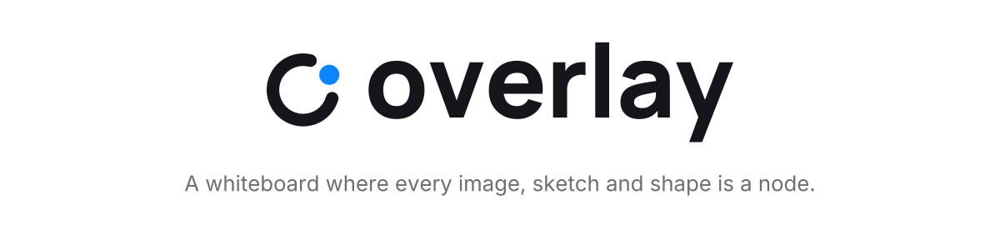
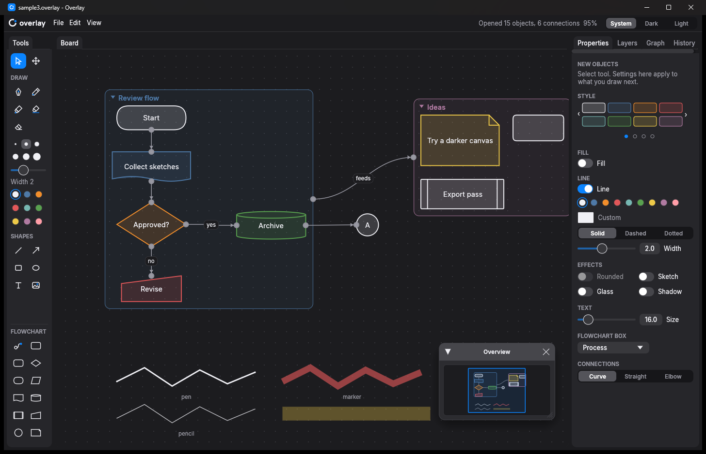

<p align="center">
  <picture>
    <source media="(prefers-color-scheme: dark)" srcset="brand/svg/overlay-readme-header-dark.svg">
    
  </picture>
</p>

<p align="center">
  <a href="https://github.com/gowthamjeyabalan/overlay/releases/latest"></a>
  
  
  <a href="LICENSE"></a>
</p>

**Overlay** is a fast, lightweight whiteboard for Windows. Drop in images, sketch with a pen, marker or highlighter, and build flowcharts. Every item on the board is a node with ports on all four sides, so an image, a scribble, a text box or a whole group can be connected to anything else. Connections show relationships; they do not carry data.

<p align="center"></p>

## Download

Get `overlay.exe` from the [latest release](https://github.com/gowthamjeyabalan/overlay/releases/latest) and run it. There is nothing to install: it is a single 10 MB file and needs Windows 10 or 11. Try it on [`examples/demo.overlay`](examples/demo.overlay).

## Features

**Draw and place**
- Pen, pencil, marker and highlighter, each with its own width from hairline (0.25) to very thick (200). Strokes are smoothed as you draw.
- Lines, arrows, rectangles, ellipses and text.
- Polylines: click to add corners, straight or as a smooth curve. Click the first point again to close the shape and fill it.
- Images by drag and drop from Explorer, Ctrl+V (including screenshots) or Ctrl+I.
- Eleven flowchart shapes: empty node, process, decision, start or end, input or output, document, database, subprocess, manual input, connector and note.

**Connect everything**
- Every item has a port in the middle of each side. Drag from a port to another item to connect them.
- Curved, straight or right-angle (elbow) connections, with labels such as "yes" or "no".
- Press `/` to add an item from a searchable list. With a node selected, the new item appears beside it, already connected and ready to type in, so a flowchart can be built from the keyboard alone.
- Drag a connection into empty space and the same list opens there.

**Organise**
- Named, coloured groups that move together, have their own ports, nest, and collapse into a single node.
- Sketches: group strokes alone and they join into one item with no frame, which moves, resizes and connects as one.
- Layers you make yourself: name them, reorder them to choose what is in front, and move items between them.
- Snapping to other items' edges, centres and equal gaps while you move or resize, with guide lines. Hold Alt to skip it.
- Lock items, change opacity, and add comment threads to any item.
- A radial menu: hold the right mouse button on an item, or hold it still on empty board, and move to an action, then let go. Add opens sections (Draw, Shapes, Flowchart, Note, Image) that each open a further ring of tools or items, Tools has select, pan and connect, Width and Colour set the line for the selection and for what you draw next, View has zoom to fit, the Overview and snapping, and Layer and Arrange open a second ring to pick from; Delete, Duplicate, Lock, Group and Properties act straight away. This is where the tools live; there is no toolbar.
- A Graph panel listing connections, and a floating Overview map of the whole board.

**Notes**
- A Notes list on the left shows every note as a card with a preview, in folders you make. Double-click a note to open it in its own tab beside the board, to write, read, or both side by side.
- Markdown notes: headings, bold, italic, strikethrough, code, quotes, lists, tasks you can tick, tables, web links and `[[Name]]` links to other notes or items.
- Place a note on the board as a card: it can be resized, scrolls inside itself, and connects, groups and layers like any item. The same note can have several cards.
- Pasting markdown or dropping `.md` files onto the window makes notes.
- Backlinks: a note's tab lists the notes that link to it and those that mention it. Typing `[[` suggests note names; a link to a note that does not exist yet shows paler, and following it (a click when reading, Ctrl+click when writing) makes that note and opens it. Dotted lines join the cards of linked notes on the board (View > Links between note cards).

**Pages, frames and presenting**
- Several pages in one board, as a row of buttons under the board. Each page has its own items; notes are shared by all pages.
- Frames mark named areas of a page (the Frame tool, F; Shift keeps 16:9) and carry what is inside them when moved. The Frames panel lists them in slide order.
- Present (F5) shows the frames full screen one by one; arrow keys or a click move on, Esc returns.

**Search everything**
- Ctrl+K finds notes, text, comments and connection labels on every page, and frames, layers and pages, and runs any command or tool by name.

**Calendar**
- Every item records when it was made and each day it was changed, automatically.
- The Calendar panel shows a week as day cards, each listing that day's items, with a bar showing how much was done.
- Choose days to highlight their items on the board, or show only those items.

**Style**
- Style presets, solid or gradient fills, solid, dashed or dotted lines, rounded corners, and sketch, glass and shadow effects.
- An eyedropper that takes a colour from any item, or from a pixel of an image.
- Dark, light, or follow Windows.

**Undo**
- Ctrl+Z and Ctrl+Y undo and redo the last 100 changes while Overlay is open.

**Share**
- Export the board, the selection or the visible area as PNG or JPG, at up to 4x, with an optional transparent background.

## Keyboard

These are the defaults; every tool and most commands can be given other keys in Settings > Keyboard shortcuts.

| Keys | Action |
|---|---|
| V, H | Select, pan |
| P, B, K, Y, E | Pen, pencil, marker, highlighter, eraser |
| L, A, U, R, O, T | Line, arrow, polyline, rectangle, ellipse, text |
| N, C | Flowchart shape, connect |
| `/` | Add an item (connected to the selection) |
| Enter | Edit the selected item's label |
| Ctrl+G, Ctrl+Shift+G | Group, ungroup (strokes alone join into one sketch) |
| Ctrl+L | Lock or unlock |
| Ctrl+D, Delete | Duplicate, delete |
| Ctrl+Z, Ctrl+Y | Undo, redo |
| Ctrl+C, Ctrl+X, Ctrl+V | Copy, cut, paste (images and text too) |
| Ctrl+[, Ctrl+] | Send to back, bring to front |
| Arrow keys | Nudge (Shift for 10) |
| Ctrl+0, Shift+1 | Actual size, zoom to fit |
| M | Show or hide the Overview |
| Ctrl+E | Export an image |
| Ctrl+K | Search everything, run a command |
| Ctrl+, | Settings |
| F, F5 | Frame tool, present |
| Ctrl+N, Ctrl+O, Ctrl+S, Ctrl+Shift+S | New, open, save, save as |

Pan with the middle mouse button, the right mouse button on empty board, or hold Space and drag. Holding the right button on an item opens the radial menu. The mouse wheel zooms at the pointer.

<details>
<summary><b>More detail on how things work</b></summary>

| Topic | How |
|---|---|
| Resize | Drag any of the eight handles around a selected item. Corner handles keep an image's shape (Shift frees it). |
| Corner radius | Drag the small diamond inside a selected shape's top-left corner, or use Rounded and Corner in Properties. |
| Labels | Double-click an item, or select it and press Enter. Images and sketches get a caption. Double-click empty board for new text. |
| Connections | Drag from a port to another item's port, or anywhere on it (the facing side is used). The Connect tool connects from anywhere on an item. Double-click a connection to label it. |
| Polylines | With the Polyline tool (U), click to add points; double-click or Enter ends the line, Esc drops it, Backspace takes back a point, Shift keeps 45° steps. Clicking the first point closes the shape. Straight or Curved is set in the Shapes panel and per line in Properties. |
| Sketches | Select only strokes and press Ctrl+G: they become one sketch with no frame. Ctrl+Shift+G splits it back into strokes. |
| Layers | New layer adds one above the current layer, which is where new and pasted items go. Click a layer to make it current, double-click to rename, use the arrows to reorder, Move to put the selected items on it. Deleting a layer deletes what is on it. |
| Groups | Ctrl+G groups the selection. Double-click the name to rename it; Properties sets its colour and fill. Click the arrow beside the name to collapse it; connections to what is inside then attach to the group. |
| Locking | Locked items can be selected but not moved, edited, erased or deleted. |
| Comments | Click the speech bubble at an item's top-right corner. Ctrl+Enter posts. |
| Radial menu | Hold the right button on an item (it is selected if it was not), or hold it still for a moment on empty board, and move outward to an action; let go to do it. Moving onto Add, Tools, Width, Layer, Colour, Arrange or View opens an outer ring (Add's sections open a third): move onto a colour, a layer or front/back and let go. Letting go in the middle, or pressing Esc, cancels. A quick right-click leaves the ring open to click in. |
| Notes | New note starts one (in the folder picked in the list) and opens it in a tab; Write, Split and Read switch between the editor and the preview. Double-click a note in the list, or its card on the board, to open it. Click notes in the list to pick them (Ctrl-click for more) and press Delete to delete them. New folder makes a folder; double-click its name to rename it, drag notes onto it to move them in, and click its arrow to fold it. Holding the right button on a note in the list opens its ring: open, place on board, move to a folder, delete. On the board, a selected note card's ring has a Note section with the same. Place on board adds a card; The mouse wheel over a card scrolls it (Ctrl+wheel zooms). Click a checkbox on a card to tick it, or a link to follow it. Deleting a note also deletes its cards. |
| Settings | File > Settings…, Ctrl+, or Ctrl+K "Settings". Sections for appearance (mode, interface size), the board, drawing, notes, the radial menu, undo, files, and keyboard shortcuts. In Keyboard shortcuts, click a shortcut and press the new keys; a shortcut belongs to one action, so giving it to another moves it. Esc, Delete, Enter, the arrows, copy and paste, and Space stay fixed. |
| Pages | Click a page button under the board to show it, double-click to rename it, + adds one, and the × beside the current page deletes it with what is on it (Ctrl+Z brings it back). Each page keeps its own view. |
| Frames | Frames sit behind everything and are picked by their edge or name. Double-click the name to rename it. In the Frames panel, click a frame to go to it, use the arrows to change the slide order, and ▶ to present from it. |
| Calendar | Click a day to choose it, Ctrl-click to add days. Highlight fades the other items; Only these days hides them. Click an item in a day to select it and bring it into view. |
| Panels | Notes, Calendar, Properties, Layers, Frames and Graph are dockable tabs. View > Reset panel layout restores the default. |

</details>

## Build from source

You need [Rust](https://rustup.rs) (stable) on Windows.

```
git clone https://github.com/gowthamjeyabalan/overlay
cd overlay
cargo run --release
```

`cargo run --release -- path\to\board.overlay` opens a board directly. Use the release build: debug builds are much slower.

## How it is built

Overlay is written in Rust with [egui](https://github.com/emilk/egui) and [egui_dock](https://github.com/Adanos020/egui_dock), using the OpenGL renderer to stay light. Boards are `.overlay` files: JSON with images embedded.

| File | What it holds |
|---|---|
| `src/board.rs` | Items, connections, images, groups and the file format |
| `src/editor.rs` | Selection, clipboard, image import, comments, open and save |
| `src/history.rs` | Undo and redo |
| `src/canvas.rs` | Camera, the tools' pointer gestures, drawing |
| `src/shapes.rs` | Shape outlines, fills, dashes and effects |
| `src/snap.rs` | Snapping to edges, centres and equal gaps |
| `src/insert.rs` | The `/` list |
| `src/export.rs` | PNG and JPG export (a small software renderer) |
| `src/panels.rs`, `src/overview.rs` | Notes, Properties, Layers, Frames, Graph and the Overview |
| `src/radial.rs` | The radial menu: tools, new items and actions on the selection |
| `src/markdown.rs` | Reading and drawing notes' markdown |
| `src/search.rs` | Search everything (Ctrl+K) |
| `src/dates.rs`, `src/calendar.rs` | Dates on items and the Calendar |
| `src/app.rs`, `src/theme.rs` | Window, menus, shortcuts, settings, and the theme |

The look follows the **Grapht** design system: a quiet grey interface with one blue accent, Inter type, and round strokes. Its tokens and notes are in [`design/`](design). The logo is an "O" left open and closed by a blue dot; the brand kit and its generator are in [`brand/`](brand).

## Licence

Overlay is released under the [MIT licence](LICENSE). The bundled Inter and Manrope fonts are under the [SIL Open Font License](assets/fonts/OFL.txt).
